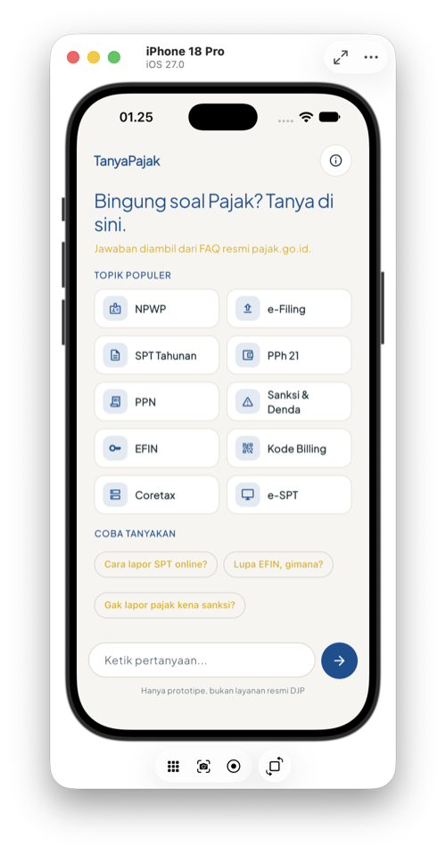
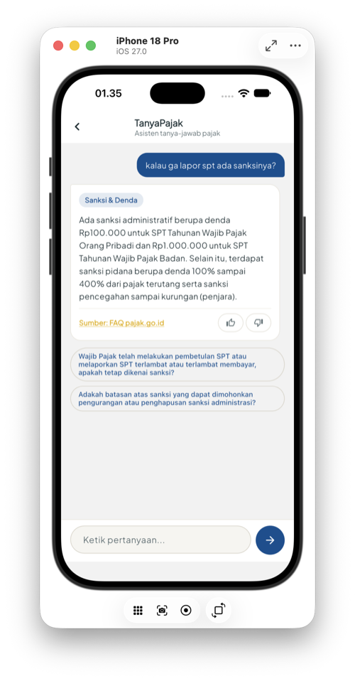
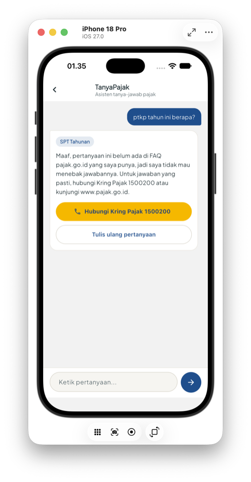
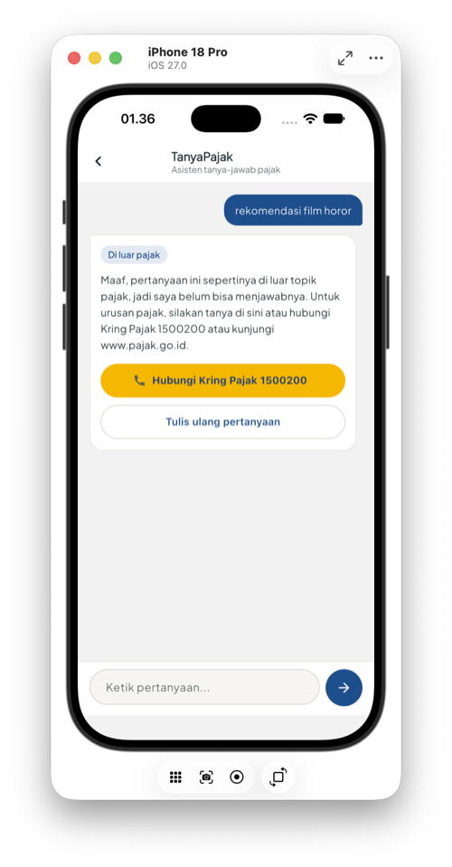

# TanyaPajak

Proyek akhir mata kuliah Artificial Intelligence. Aplikasinya buat tanya-jawab seputar
pajak: pertanyaan pengguna disaring dulu (pajak atau bukan), lalu diklasifikasi
topiknya, terus dicari FAQ pajak.go.id yang paling mirip. Kalau FAQ-nya tidak ada atau pertanyaannya bukan
soal pajak, sistem bilang terus terang dan mengarahkan ke Kring Pajak 1500200.

Semuanya pakai machine learning klasik dari scikit-learn: TF-IDF dan SVM untuk
penyaring dan klasifikasi topik, lalu kemiripan TF-IDF untuk mencari FAQ. Tidak ada
LLM, API AI, atau model pretrained.

Isinya tiga bagian. Folder `training-ml/` berisi notebook dan dataset (ini yang
dikumpulkan sebagai Project Final). Folder `backend/` berisi API FastAPI yang memuat model
`tanyapajak_lengkap.joblib` hasil notebook. Folder `lib/` berisi aplikasi Flutter-nya.

## Tampilan aplikasi

Diambil dari simulator iPhone 18 Pro (iOS 27).

| Beranda | Jawaban dari FAQ | FAQ tidak ada | Di luar pajak |
| :---: | :---: | :---: | :---: |
|  |  |  |  |

Dari kiri ke kanan: halaman awal dengan topik populer, pertanyaan yang FAQ-nya ketemu,
pertanyaan pajak yang FAQ-nya belum ada (jadi diarahkan ke Kring Pajak), dan pertanyaan
yang bukan soal pajak.

## Dataset

Datanya ada di `training-ml/dataset-tanyapajak.csv`, isinya 848 baris. Sebanyak 777 di
antaranya pertanyaan pajak dari FAQ pajak.go.id yang diambil 27 September sampai 10
Oktober 2026, beserta parafrasenya, dan terbagi ke 11 topik (PPN, SPT Tahunan, NPWP,
e-Filing, Coretax, dan lain-lain). Sisanya 71 pertanyaan bukan pajak yang saya tulis
sendiri untuk melatih penyaring. Penjelasan tiap kolom ada di notebook bagian 2.

## Notebook

`training-ml/TanyaPajak.ipynb` bisa dijalankan di Google Colab atau di komputer
sendiri. Di Colab, dataset dibaca dari Drive
(`MyDrive/ArtificialIntelligenceALP/dataset-tanyapajak.csv`). Di komputer sendiri,
dataset dibaca dari folder yang sama dengan notebook. Kalau jalan di komputer sendiri,
selain library di `backend/requirements.txt` perlu juga `jupyter`, `matplotlib`, dan
`seaborn`.

Di akhir, notebook menyimpan `tanyapajak_lengkap.joblib`. Kalau dataset atau notebook
diubah, file ini yang disalin ke `backend/`.

## Backend

Pakai Python 3.13 dan scikit-learn 1.6.1. Versi scikit-learn harus sama dengan yang
dipakai waktu menjalankan notebook, kalau beda model bisa gagal di-load.

```bash
cd backend
python3.13 -m venv venv
source venv/bin/activate
pip install -r requirements.txt
uvicorn main:app --reload --host 0.0.0.0 --port 8000
```

Kalau sudah jalan, buka http://127.0.0.1:8000/docs untuk coba endpoint-nya.

Ada dua endpoint yang dipakai aplikasi:

- `POST /predict` dengan body `{"pertanyaan": "..."}`
- `GET /jawaban/{topik}?pertanyaan=...`, dipanggil kalau pengguna memilih salah satu
  saran topik. Pertanyaan aslinya ikut dikirim, lalu FAQ dicari hanya di topik yang
  dipilih dengan ambang skor yang sama (0.40). Kalau tidak ada yang cukup mirip,
  jawabannya tetap ditolak dengan jujur

Contoh respons `/predict`:

```json
{"topik": "EFIN", "confidence": 0.92, "jawaban": "...", "sumber": "https://...",
 "label_sumber": "Sumber: FAQ pajak.go.id", "saran_topik": ["EFIN", "e-Filing", "PPN"],
 "pertanyaan_terkait": ["..."], "faq_ditemukan": true}
```

Urutan yang dicek backend:

1. Kalau penyaring menilai pertanyaannya bukan soal pajak (peluang minimal 50%),
   `topik` diisi `"Di luar pajak"`, `saran_topik` dikosongkan, dan jawabannya pesan
   sopan yang mengarahkan ke Kring Pajak atau pajak.go.id.
2. Kalau tidak ada satu kata pun yang dikenal model (misalnya "halo"), `saran_topik`
   dikosongkan dan aplikasi cuma minta pengguna menulis ulang pertanyaannya.
3. Kalau confidence topiknya di bawah 0.5, aplikasi menampilkan layar "kurang yakin"
   berisi tiga saran topik dan tombol Kring Pajak.
4. Kalau topiknya yakin, FAQ dicari di topik itu. Kalau tidak ada yang skornya minimal
   0.40, pencarian diulang di semua topik. Kalau tetap tidak ada, `faq_ditemukan`
   bernilai `false` dan aplikasi menampilkan tombol Kring Pajak di kartu jawaban.

## Aplikasi Flutter

Nyalakan backend dulu, baru di terminal lain:

```bash
flutter pub get
flutter run
```

Alamat API diatur di `lib/config.dart` dan sudah otomatis: `10.0.2.2` untuk
emulator Android, `127.0.0.1` untuk macOS dan simulator iOS. Kalau dites
di HP langsung, ganti dengan IP laptop (HP dan laptop harus satu wifi).

Test-nya bisa dijalankan dengan `flutter test`.

### Versi web

Aplikasi juga bisa dijalankan di browser, jadi tidak harus pakai macOS. Backend
tetap harus nyala dengan `--host 0.0.0.0` seperti di atas.

```bash
# coba cepat di Chrome
flutter run -d chrome

# atau build sekali, lalu buka dari browser mana pun di wifi yang sama
flutter build web
python3 -m http.server 5000 -d build/web
```

Setelah itu buka http://localhost:5000 di laptop, atau http://IP-laptop:5000 dari HP.
Versi web otomatis memanggil backend di host yang sama dengan halamannya (port 8000),
jadi alamat API tidak perlu diganti. Backend sudah mengizinkan CORS supaya browser
boleh memanggilnya.

Tombol telepon Kring Pajak cuma jalan di browser HP, di browser laptop tidak bisa
membuka aplikasi telepon.

## Contoh pertanyaan buat demo

Pertanyaan yang FAQ-nya ketemu dan jawabannya enak dilihat:

- "lupa password djp online" masuk e-Filing, dapat langkah reset lewat EFIN
- "kalau ga lapor spt ada sanksinya?" masuk Sanksi & Denda, dapat nominal dendanya
  (Rp100.000 untuk orang pribadi)
- "beda spt 1770 sama 1770 s" masuk SPT Tahunan, dijelaskan tiga jenis formulirnya
- "nik jadi npwp gimana caranya" masuk NPWP, dapat jalur pemadanan NIK
- "cara batalin kode billing" masuk Kode Billing, dijawab bahwa kode billing tidak bisa
  dihapus
- "coretax itu apa" masuk Coretax dengan keyakinan 0.95

Yang pajak tapi FAQ-nya tidak ada, jadi sistem tidak menebak dan muncul tombol Kring
Pajak:

- "ptkp tahun ini berapa"
- "pajak kendaraan bermotor bayar dimana" (ini memang bukan urusan DJP, tapi Samsat)

Sisanya buat nunjukin penyaring dan layar lain:

- "rekomendasi film horor" atau "cara transfer bank bca" ditolak karena bukan soal pajak
- "lapor pajak" keyakinannya cuma 0.34 karena terlalu pendek, jadi muncul layar "kurang
  yakin" dengan saran topik Umum, e-Filing, dan SPT Tahunan
- "resep nasi goreng enak" tidak ada kata yang dikenal, jadi muncul pesan "belum paham"

## Keterbatasan

Cakupan FAQ masih terbatas, jadi banyak pertanyaan pajak yang wajar (misalnya PTKP
atau berapa potongan PPh 21 dari gaji) belum bisa dijawab. Pencarian FAQ juga masih
berbasis kata, belum memahami makna kalimat, dan penyaring kadang masih meloloskan
pertanyaan umum seperti "siapa presiden indonesia sekarang". Hasil evaluasi lengkap,
angka sebelum dan sesudah perbaikan, dan rencana pengembangannya ada di
`docs/summary.md`. Penjelasan isi tiap file ada di `docs/struktur-file.md`.
